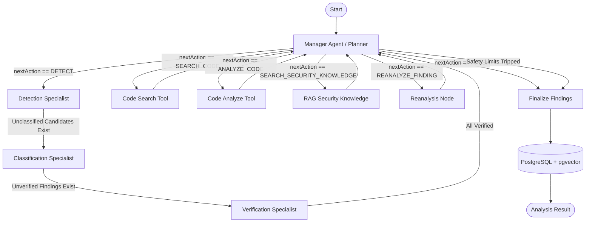

CodeShield AI

CodeShield AI is a security analysis tool for finding common vulnerabilities in source code and small project archives.

The project combines Semgrep for static analysis with a small LLM-based analysis pipeline. The LLM is used to interpret findings, assign CWE information, explain the issue, and review the result before it is returned.

This started as a B.Tech project / prototype. It now also includes the hardening needed to run it as a small, free-tier-friendly production service: Google-authenticated endpoints, rate limiting, a bounded concurrency limit, multi-provider LLM fallback, and a non-root Docker image.

What it does

Accepts source code directly or as a ZIP project

Runs Semgrep without executing the submitted code

Extracts relevant code around reported findings

Uses security-related reference material through a PostgreSQL + pgvector knowledge base

Runs three analysis stages:

Detection

Classification and localization

Verification

Returns severity, confidence, CWE, location, explanation, and remediation

Validates LLM responses before using them

Applies limits and checks when handling ZIP uploads

How the analysis works (LangGraph StateGraph)

The analysis orchestrator executes a compiled LangGraph `StateGraph` that manages autonomous planning, specialists, tool execution, and deterministic security gates:

Deterministic gates enforce that:
1. Candidate findings produced by Detection or Semgrep **must** be batch-classified before any other action can execute.
2. Classified findings **must** be batch-verified before the manager can take another action or conclude the analysis.
3. Safety limits (deadline, max tool calls, max iterations) are code-enforced in graph routers, unconditionally taking priority over model decisions.

Tech stack

Backend:
- Node.js (18+) & TypeScript
- Express
- LangGraph.js (`@langchain/langgraph`) — stateful agent orchestration graph
- LangChain.js (`@langchain/core`, `@langchain/google-genai`, `@langchain/openai`) — chat models, prompt templates, and RAG retrievers
- Prisma & PostgreSQL with `pgvector`
- Semgrep for static code analysis
- Multi-provider fallback: Google Gemini (primary), xAI Grok (1st fallback), OpenAI-compatible Llama (2nd fallback)
- Google Sign-In (ID token verification via `google-auth-library`)
- Zod (schemas and structured output validation with single repair retry)
- Jest / Supertest for unit and integration testing

Frontend

The frontend will provide the interface for submitting code/projects and viewing analysis results.

Repository structure

CodeShield-AI/
├── backend/
│   ├── prisma/
│   ├── semgrep-rules/
│   ├── src/
│   ├── tests/
│   ├── Dockerfile
│   ├── package.json
│   └── ...
│
├── frontend/
│   └── ...
│
└── README.md

Authentication

The analysis endpoints (`/api/analyze`, `/api/analyze/upload`) require a Google ID token. There is no separate username/password or session system.

1. The frontend signs the user in with Google Sign-In and obtains an ID token.
2. Every request to `/api/*` sends that token as `Authorization: Bearer <id_token>`.
3. The backend verifies the token directly against Google (signature, expiry, issuer, and that the `aud` claim matches `GOOGLE_CLIENT_ID`) using `google-auth-library`. No LLM or Google API key is ever sent to or exposed in the frontend.

`GET /health` does not require authentication (used for platform health checks).

Backend API

Analyze source code

POST /api/analyze
Authorization: Bearer <google_id_token>
Content-Type: application/json

Example:

{
  "language": "javascript",
  "code": "const query = 'SELECT * FROM users WHERE id=' + req.query.id;"
}

Analyze a ZIP project

POST /api/analyze/upload?language=auto
Authorization: Bearer <google_id_token>
Content-Type: multipart/form-data

Upload the project as the file field.

When language=auto, the backend uses file extensions to determine the language.

Health check

GET /health

Multi-provider LLM (Gemini -> Grok -> Llama)

All agent calls go through a single internal `LlmService` interface. Behind it, a router tries configured providers in order (Gemini first by default) and falls back to the next one on a provider-side problem: rate limit/quota, timeout, outage, 5xx, or an unavailable model. An application-level error (e.g. the LLM's JSON failing our own schema validation) does *not* trigger a provider fallback — that's not a provider problem.

- Order is controlled by `LLM_PROVIDER_ORDER` (default `gemini,grok,llama`).
- Each provider is optional individually — you can run with only `GEMINI_API_KEY` set. At least one provider must be configured, or the server refuses to start (see "Startup validation").
- **Grok**: uses xAI's OpenAI-compatible API at `https://api.x.ai/v1` (fixed in code). Set `GROK_API_KEY` and `GROK_MODEL` — current flagship is `grok-4.6`; `grok-4.5`/`grok-4.3` are cheaper alternatives with a 1M-token context window. xAI retires older model ids periodically (e.g. `grok-3`, `grok-4-0709` on May 15, 2026), so check https://docs.x.ai/docs/models before deploying.
- **Llama**: served through any OpenAI-compatible `/chat/completions` endpoint you configure via `LLAMA_BASE_URL` + `LLAMA_MODEL` (+ optional `LLAMA_API_KEY`). Works with Groq, Together AI, Fireworks, OpenRouter, or a self-hosted vLLM/Ollama instance — see the commented examples in `.env.example`. Provider model lineups change frequently (Groq deprecated Llama 4 Maverick in Feb 2026, for example), so verify against the chosen provider's current docs before deploying.
- Per-provider timeouts/retries are intentionally small (`AI_REQUEST_TIMEOUT_MS`, `AI_MAX_RETRIES`) so a full Gemini -> Grok -> Llama fallback chain still fits inside `AGENT_MAX_ANALYSIS_TIME_MS`, and so retries don't burn through free-tier quotas.

Rate limiting and concurrency

- `RATE_LIMIT_WINDOW_MS` / `RATE_LIMIT_MAX_REQUESTS`: a sliding request budget applied to all of `/api/*`, per client IP.
- `MAX_CONCURRENT_ANALYSES`: caps how many analyses (paste or ZIP) can run at the same time on this instance. Extra requests get an immediate `503` instead of queueing indefinitely, since analyses can take up to `AGENT_MAX_ANALYSIS_TIME_MS`.

Both are simple in-memory checks (no Redis/queue) — appropriate for a single free-tier instance. If you later run more than one instance behind a load balancer, move these to a shared store.

Running the backend locally

Go to the backend directory:

cd backend

Install dependencies:

npm install

Create the environment file:

cp .env.example .env

Set the required values in .env: at least one LLM provider (GEMINI_API_KEY is simplest), GOOGLE_CLIENT_ID, and the database connection.

Run the Prisma setup:

npx prisma generate
npx prisma migrate deploy
npx prisma db seed

Install Semgrep separately and make sure it is available on PATH.

Start the development server:

npm run dev

For a production build:

npm run build
npm start

Running with Docker

docker build -t codeshield-backend .
docker run --rm -p 3000:3000 --env-file .env codeshield-backend

The image installs Semgrep at build time and runs the Node process as a dedicated non-root user (`appuser`), not root.

Environment variables

The full list, with comments, is kept in .env.example. Key groups:

- Database: DATABASE_URL
- LLM providers: GEMINI_API_KEY, GEMINI_MODEL, GROK_API_KEY, GROK_MODEL, LLAMA_API_KEY, LLAMA_BASE_URL, LLAMA_MODEL, LLM_PROVIDER_ORDER, EMBEDDING_MODEL, AI_REQUEST_TIMEOUT_MS, AI_MAX_RETRIES
- Auth: GOOGLE_CLIENT_ID
- Rate limiting / concurrency: RATE_LIMIT_WINDOW_MS, RATE_LIMIT_MAX_REQUESTS, MAX_CONCURRENT_ANALYSES
- Misc: CORS_ORIGIN, SEMGREP_PATH, and the existing code/ZIP size limits

Do not commit .env or any API keys.

Startup validation

The server checks its configuration before accepting traffic and exits with a clear error if:

- no LLM provider is fully configured (none of Gemini/Grok/Llama has the required variables set), or
- GOOGLE_CLIENT_ID is missing.

It never logs secret values, only which variables are missing.

Security considerations

The backend treats submitted projects as untrusted input, including for prompt-injection attempts embedded in source code — agent tool calls are limited to a fixed, code-enforced set (see the orchestrator), so the LLM's output can influence analysis *decisions* within that set but never execute arbitrary code or tools.

Source code is scanned; it is not executed or compiled.

Semgrep is started with an argument array rather than a shell command.

ZIP extraction checks for path traversal and size/file-count limits.

Temporary workspaces are removed after analysis.

Raw submitted source is not kept as permanent analysis data, and is not written to logs (logs record language/size/status, not source content).

AI responses are validated with Zod before being used.

Request and upload limits are configurable.

Analysis endpoints require a verified Google identity, are rate-limited, and are capped by a concurrency limit.

The Docker image runs as a non-root user.

Testing

Run:

npm test

The test suite covers input validation, Semgrep integration, AI response validation, the analysis pipeline, ZIP extraction checks, API behavior, LLM provider fallback (Gemini -> Grok -> Llama, including timeout/rate-limit/outage scenarios and the "no unnecessary fallback" case), Google auth, rate limiting, and the concurrency limit.

The LLM is mocked in tests, so no real Gemini/Grok/Llama credentials are required for the test suite. Google token verification is also mocked, so no real Google Client ID/network call is required.

Current scope

The custom Semgrep rules currently cover:

JavaScript

TypeScript

Python

The security knowledge base contains starter material for common issues such as SQL injection, XSS, command injection, path traversal, SSRF, hardcoded credentials, weak cryptography, and insecure deserialization.

Detection quality depends on the source code, Semgrep coverage, the available security knowledge, and the LLM response.

Free-tier notes: this is designed to run as a single instance with in-memory rate limiting/concurrency control and no external queue — appropriate for a free/starter-tier deployment, but it will not horizontally scale without moving those to a shared store.

License

This project is currently intended as an academic project.
