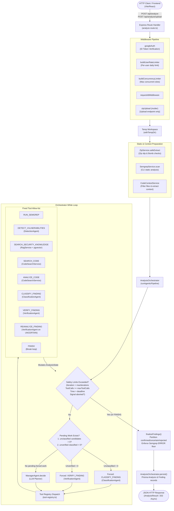

# Phase 1: Architecture Audit — CodeShield-AI Backend

## 1. Executive Summary

CodeShield-AI is an agentic AI security vulnerability analysis system designed for multi-language source code analysis. The backend is built with TypeScript, Node.js (18+), Express, Prisma (PostgreSQL with pgvector for RAG), Semgrep static analysis, and Zod schema validation.

This audit inspects the current architecture, details the control flow, maps files to domain concepts, and analyzes technical risks associated with refactoring the orchestration and LLM plumbing to **LangChain.js** and **LangGraph.js**.

---

## 2. Current Architecture & Control Flow

### 2.1 High-Level Architecture Flow



### 2.2 Sequence of Operations in `runAgenticPipeline`

1. **State Initialization**: Initializes `AnalysisState` with code references, empty candidate findings, empty classified findings, an empty `verifiedById` Map, empty knowledge chunks, and zero counters.
2. **Deterministic Priority Check (`nextDeterministicAction`)**:
   - If there are candidate findings not yet in `classifiedFindings`, forces `CLASSIFY_FINDING`.
   - If there are classified findings not yet in `verifiedById`, forces `VERIFY_FINDING`.
   - This priority prevents the LLM planner from spending iterations or burning rate limits when downstream work is waiting.
3. **Planner Decision (`ManagerAgent.decide`)**:
   - Only executed when no deterministic work is queued.
   - Given a compact summary of state (counts, recent actions, unresolved finding IDs), returns `{ action, arguments, reason }`.
4. **Tool Execution (`createToolRegistry`)**:
   - Dispatches only to the allow-listed tools.
   - Mutates `AnalysisState` directly (appending findings, merging candidates with `dedupeMerge()`, storing verification results in `verifiedById`).
5. **Termination Conditions**:
   - `decision.action === 'FINISH'`
   - `state.iteration > env.agent.maxIterations` (default: 8)
   - `state.toolCallCount >= env.agent.maxToolCalls` (default: 12)
   - `Date.now() > deadline` (default: 45s)
   - `signal.aborted` (client disconnect via HTTP socket close)
6. **Finalization (`finalizeFindings`)**:
   - Evaluates each classified finding against `verifiedById`:
     - `CONFIRMED` $\rightarrow$ added to `vulnerabilities`.
     - `REJECTED` $\rightarrow$ checked against Semgrep findings. If a Semgrep `ERROR`-level finding overlaps with the rejected finding and no valid reason is stored, it is demoted to `UNCERTAIN`. Otherwise, it is counted as `rejectedCount` and **never returned to the client**.
     - `UNCERTAIN` $\rightarrow$ added to `uncertainFindings`.
     - Not verified (hit timeout/budget before verification) $\rightarrow$ added to `uncertainFindings` with status `UNVERIFIED`.
   - Sets `partial = true` if timeout was hit, or unclassified candidates remain, or uncertain findings exist.

---

## 3. File-to-Concept Mapping

| Current File | Role & Domain Concept | Candidate Target in LangChain / LangGraph Architecture |
|---|---|---|
| **Orchestration & State** | | |
| `backend/src/orchestrator/analysis.orchestrator.ts` | Hand-rolled `while` loop, hard safety bounds, pipeline runner, persistence trigger | Replaced by compiled `StateGraph` runner. Validation, workspace setup, and DB persistence remain outside the graph. |
| `backend/src/orchestrator/tool-registry.ts` | Hand-written handlers mutating `AnalysisState`, `dedupeMerge` helper | Converted into LangGraph nodes / LangChain `tool()` definitions with Zod schemas. State mutation moved to immutable State reducers. |
| `backend/src/types/agent-state.ts` | In-memory `AnalysisState` interface, `AGENT_ACTIONS` enum, `ManagerDecision` | Replaced/backed by `Annotation.Root({ ... })` defining LangGraph channels and reducers. |
| **Agents & Prompts** | | |
| `backend/src/agents/manager.agent.ts` | Manager planner invoking `generateStructured` with state JSON | Manager planner node in LangGraph using chat model with structured output. |
| `backend/src/agents/detection.agent.ts` | Agent 1: 1 LLM call analyzing code + Semgrep evidence | Detect node in LangGraph calling chat model with structured output. |
| `backend/src/agents/classification.agent.ts` | Agent 2: 1 LLM call mapping candidates to CWE, line numbers, explanations | Classify node in LangGraph calling chat model with structured output. |
| `backend/src/agents/verification.agent.ts` | Agent 3: 1 LLM call confirming / rejecting / marking uncertain | Verify & Reanalyze nodes in LangGraph calling verification chat model. |
| `backend/src/agents/prompts/*.prompt.ts` | Raw string prompts with anti-prompt-injection delimiters | Ported to LangChain `ChatPromptTemplate` maintaining exact delimiters and anti-injection instructions. |
| **LLM & Infrastructure** | | |
| `backend/src/services/llm/llm.service.ts` | Custom `LlmService`, `LlmRequest`, `LlmResponse` interfaces | Replaced by LangChain `BaseChatModel` standard interfaces. |
| `backend/src/services/llm/llm-router.ts` | Hand-written fallback loop (Gemini $\rightarrow$ Grok $\rightarrow$ Llama) on provider errors only | Replaced by LangChain model fallback (`.withFallbacks()`) configured to filter on provider-level errors. |
| `backend/src/services/llm/llm-factory.ts` | Instantiates providers based on `LLM_PROVIDER_ORDER` and env vars | Builds `@langchain/google-genai` and `@langchain/openai` model instances with fallback. |
| `backend/src/services/llm/gemini.service.ts` | Direct `@google/genai` SDK wrapper with exponential backoff & timeout | Replaced by `@langchain/google-genai` `ChatGoogleGenerativeAI`. |
| `backend/src/services/llm/providers/generic-openai.provider.ts` | Fetch-based OpenAI chat completion wrapper for Grok / Llama | Replaced by `@langchain/openai` `ChatOpenAI` with custom `baseURL`. |
| `backend/src/services/llm/structured-output.ts` | JSON fence stripping, Zod parse, single repair retry | Replaced by `.withStructuredOutput(schema)` with bounded repair logic. |
| `backend/src/services/llm/timeout.ts` | `Promise.race` timeout helper | Replaced by LangChain's built-in call timeouts / `AbortSignal`. |
| **Knowledge & RAG** | | |
| `backend/src/services/rag/rag.service.ts` | Raw `$queryRaw` SQL with pgvector `<=>` cosine distance | Wrapped as a LangChain `BaseRetriever` or retriever tool calling Prisma pgvector query. |
| `backend/src/services/embeddings/gemini-embedding.service.ts` | Direct `@google/genai` embeddings call | Wrapped or replaced by `@langchain/google-genai` `GoogleGenerativeAIEmbeddings`. |
| **Untouched Core Services** | | |
| `backend/src/services/semgrep/semgrep.service.ts` | Semgrep CLI invocation, JSON parsing, error handling | **Kept as-is**. Tool node calls this service. |
| `backend/src/services/zip/zip.service.ts` | Unzip, zip-slip defense, zip-bomb defense | **Kept as-is**. Unchanged. |
| `backend/src/services/code-context/*` | Code search (regex) and snippet window extraction | **Kept as-is**. Tool nodes call these services. |
| `backend/src/config/{container,env,prisma}.ts` | DI container, environment validation, Prisma singleton | Container updated to assemble LangGraph / LangChain instances; Prisma/Env unchanged. |
| `backend/src/routes/*` & `backend/src/middleware/*` | Express routing, auth, rate-limit, concurrency, async jobs | **Kept as-is**. Routes continue to call orchestrator methods. |

---

## 4. Frontend & API Contract Compatibility

The frontend relies strictly on:
- `POST /api/analyze` (JSON `{ language, code, async? }`)
- `POST /api/analyze/upload` (multipart `file`, query `language`, `async`)
- `GET /api/analyses` and `GET /api/analyses/:id`
- Response interface `AnalysisResult`:
  ```ts
  {
    id: string;
    language: string;
    summary: { totalIssues: number; critical: number; high: number; medium: number; low: number; info: number };
    vulnerabilities: VulnerabilityResponse[];
    uncertainFindings: UncertainFindingResponse[];
    partial: boolean;
    analysisStatus: 'COMPLETE' | 'PARTIAL';
  }
  ```
The LangGraph refactoring must occur entirely **underneath** the `AnalysisOrchestrator` contract so that `analyzePastedCode` and `analyzeProject` return the identical data structures without requiring any frontend breaking changes.

---

## 5. Migration Risks & Mitigation Strategies

### Risk 1: LangGraph State Immutability and Reducers
- **Issue**: Current code mutates `AnalysisState` in-place (`state.candidateFindings.push(...)`, `state.verifiedById.set(...)`). LangGraph requires pure node functions returning partial state updates, merged via channel reducers.
- **Mitigation**: Define explicit reducers with `Annotation.Root`:
  - `candidateFindings`: Reducer using `dedupeMerge` to assign stable sequential IDs (`finding-1`, `finding-2`).
  - `classifiedFindings`: Reducer merging by finding ID.
  - `verifiedById`: Use a plain Record (`Record<string, VerificationResult>`) rather than a JS `Map` to ensure clean JSON serialization and reducer merging.
  - `evidence`, `knowledge`, `actionsTaken`: Append reducers.

### Risk 2: Deterministic Routing vs. Graph Recursion
- **Issue**: If LangGraph relies purely on the LLM Manager node to route, the model could loop repeatedly, ignore unclassified candidates, or exceed free-tier quotas.
- **Mitigation**: Conditional edge routing must strictly implement the existing `nextDeterministicAction` logic:
  - If unclassified candidates exist $\rightarrow$ route immediately to `classify`.
  - If unverified findings exist $\rightarrow$ route immediately to `verify`.
  - Check safety limits (iterations, tool calls, deadline) in the conditional router *before* routing to any node, directing to `finalize` if any limit is exceeded.
  - Set `recursionLimit` on `.invoke()` as a fail-safe backstop.

### Risk 3: Error Classification in LLM Fallbacks
- **Issue**: LangChain's `.withFallbacks()` by default falls back on *any* error (including Zod validation errors or syntax errors). If an LLM returns invalid JSON or fails the CWE schema, falling back to Grok or Llama would needlessly burn quota across all providers for a model formatting mistake.
- **Mitigation**: Ensure structured output with repair executes *inside* each model call or router layer, so only provider network/rate-limit/timeout/5xx errors trigger fallback, matching current `FALLBACK_WORTHY_CODES`.

### Risk 4: Test Suite Independence from Live APIs
- **Issue**: Over 80 tests rely on `FakeLlmService` to queue deterministic JSON strings. If LangGraph nodes require real LangChain model instances or cannot be cleanly mocked, unit and integration tests will break or require live API keys.
- **Mitigation**: Create a custom `FakeChatModel` extending LangChain's `BaseChatModel` that wraps or replaces `FakeLlmService`, allowing tests to queue canned responses and inspect calls without network requests.

### Risk 5: AbortSignal Handling
- **Issue**: When a client disconnects, Express fires `res.on('close')`, aborting the `AbortSignal`.
- **Mitigation**: Pass `{ signal }` into LangGraph's `.invoke(state, { signal })`, ensuring all underlying LangChain model calls and node operations cancel promptly.
