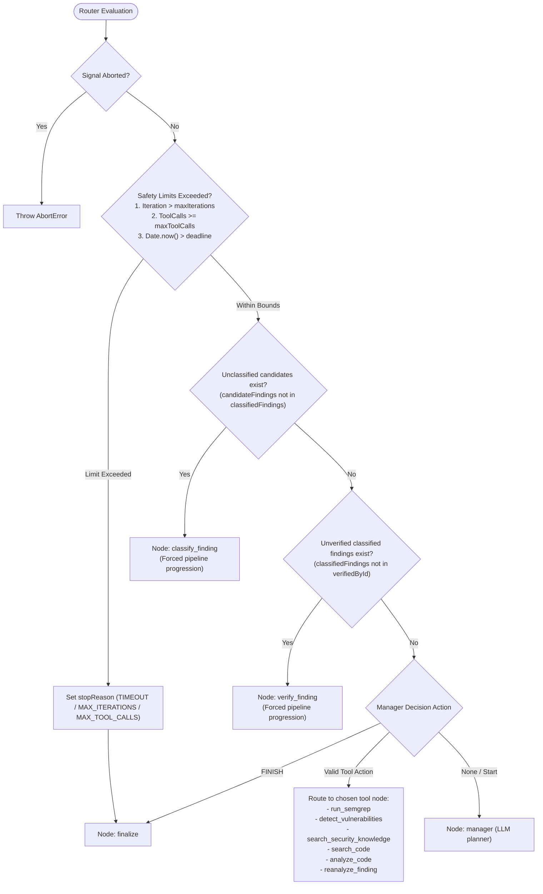

# Phase 2: Refactoring Plan — LangChain.js & LangGraph.js Migration

## 1. Overview & Objectives

Refactor the orchestration and LLM plumbing of CodeShield-AI to use **LangChain.js** and **LangGraph.js** where they replace bespoke, hand-written loops, dispatchers, and SDK wrappers, while preserving:
1. **Public API & Frontend Contracts**: Request and response shapes (`AnalysisResult`, `VulnerabilityResponse`, `UncertainFindingResponse`, `partial`, `analysisStatus`) remain completely untouched.
2. **Security Semantics**: Strict allow-listed tool execution only; submitted code is treated as untrusted data in delimited tags; Semgrep `ERROR` floor is strictly enforced.
3. **Free-Tier Call Budget**: Exactly one LLM call for Detection, one for Classification, one for Verification; single repair retry on schema failure; no unbound per-finding loops.
4. **Resilience & Fallback**: Provider fallback (Gemini $\rightarrow$ Grok $\rightarrow$ Llama) occurs **only** on provider errors (rate limit 429, timeout, 5xx, outage), **never** on schema validation errors.

---

## 2. Dependency Specification (Verified)

All versions verified via npm registry dry-run compatibility check:

| Package | Target Version | Role in Refactor |
|---|---|---|
| `@langchain/core` | `^1.2.20` | Core abstractions: `BaseChatModel`, `ChatPromptTemplate`, `tool`, `BaseRetriever` |
| `@langchain/langgraph` | `^1.5.2` | State graph engine: `StateGraph`, `Annotation`, channel reducers, conditional edges |
| `@langchain/google-genai` | `^2.3.4` | Chat model (`ChatGoogleGenerativeAI`) & Embeddings (`GoogleGenerativeAIEmbeddings`) |
| `@langchain/openai` | `^1.6.3` | Chat model (`ChatOpenAI`) for Grok (`api.x.ai`) and generic Llama endpoints |

Existing dependencies (`zod@^3.23.8`, `@prisma/client@^5.20.0`, `express@^4.21.0`) remain compatible with zero conflicts.

---

## 3. Target Directory & Module Structure

```text
backend/src/
├── graph/                          # LangGraph implementation (replaces orchestrator while loop)
│   ├── state.ts                    # Annotation.Root schema & channel reducers (dedupe, merge, append)
│   ├── nodes/                      # Graph node handlers
│   │   ├── semgrep.node.ts         # Static analysis execution node
│   │   ├── detect.node.ts          # Agent 1 Detection node
│   │   ├── classify.node.ts        # Agent 2 Classification node
│   │   ├── verify.node.ts          # Agent 3 Verification node
│   │   ├── reanalyze.node.ts       # Re-verification of UNCERTAIN findings
│   │   ├── rag.node.ts             # Knowledge base retrieval node
│   │   ├── code-search.node.ts     # In-repo code search node
│   │   ├── code-analyze.node.ts    # Bounded line-range inspection node
│   │   ├── manager.node.ts         # Planner node choosing next action
│   │   └── finalize.node.ts        # Partitions confirmed/uncertain/rejected, enforces Semgrep floor
│   ├── router.ts                   # Conditional edge: safety limits & forced Classify -> Verify
│   └── builder.ts                  # StateGraph assembly, compilation, and recursion limits
├── llm/                            # LangChain LLM plumbing (replaces custom llm.service & router)
│   ├── factory.ts                  # Instantiates ChatGoogleGenerativeAI / ChatOpenAI with providerOrder
│   ├── fallback-chain.ts           # .withFallbacks() ensuring fallback ONLY on provider-side errors
│   ├── structured-output.ts        # .withStructuredOutput(zodSchema) + bounded single repair attempt
│   └── fake-chat-model.ts          # Test fixture model extending BaseChatModel for deterministic tests
├── prompts/                        # LangChain ChatPromptTemplates (replaces raw string prompts)
│   ├── manager.prompt.ts           # Manager planner ChatPromptTemplate
│   ├── detection.prompt.ts         # Detection ChatPromptTemplate (with untrusted nonce delimiters)
│   ├── classification.prompt.ts    # Classification ChatPromptTemplate (with fixed CWE list)
│   └── verification.prompt.ts      # Verification ChatPromptTemplate (critical review)
├── tools/                          # LangChain tool() definitions
│   └── analysis-tools.ts           # SEARCH_CODE, ANALYZE_CODE, SEARCH_SECURITY_KNOWLEDGE, RUN_SEMGREP
├── services/
│   ├── rag/
│   │   ├── rag.service.ts          # Wrapped via PrismaPgvectorRetriever (BaseRetriever)
│   │   └── prisma-retriever.ts     # LangChain BaseRetriever implementation for pgvector
│   ├── embeddings/                 # GoogleGenerativeAIEmbeddings wrapper
│   ├── semgrep/                    # Left as-is
│   ├── zip/                        # Left as-is
│   └── code-context/               # Left as-is
└── orchestrator/
    └── analysis.orchestrator.ts    # Thin facade preparing workspace, running graph, and persisting to DB
```

---

## 4. Architectural Design Details

### 4.1 LangGraph State & Reducer Architecture (`src/graph/state.ts`)

`AnalysisGraphState` is defined via `Annotation.Root`:

```ts
export const AnalysisGraphState = Annotation.Root({
  // Immutable run configuration & context
  language: Annotation<string>(),
  projectRoot: Annotation<string>(),
  files: Annotation<string[]>({ reducer: (_, update) => update, default: () => [] }),
  sourceCode: Annotation<string>({ reducer: (_, update) => update, default: () => '' }),
  deadline: Annotation<number>(),
  signal: Annotation<AbortSignal | undefined>({ reducer: (_, update) => update, default: () => undefined }),

  // Semgrep findings: append with duplicate prevention (key = ruleId:file:lineStart)
  semgrepFindings: Annotation<SemgrepFinding[]>({
    reducer: (existing, incoming) => dedupeSemgrep(existing, incoming),
    default: () => []
  }),

  // Candidate findings: merged with dedupeMerge to preserve finding-1, finding-2 sequential naming
  candidateFindings: Annotation<CandidateFinding[]>({
    reducer: (existing, incoming) => dedupeCandidateFindings(existing, incoming),
    default: () => []
  }),

  // Classified findings: merged by finding ID
  classifiedFindings: Annotation<AnalyzedFinding[]>({
    reducer: (existing, incoming) => mergeClassifiedFindings(existing, incoming),
    default: () => []
  }),

  // Verification verdicts: Record<string, VerificationResult> merged by key
  verifiedById: Annotation<Record<string, VerificationResult>>({
    reducer: (existing, incoming) => ({ ...existing, ...incoming }),
    default: () => ({})
  }),

  // Knowledge & Evidence: append with content deduplication
  knowledge: Annotation<RetrievedKnowledge[]>({
    reducer: (existing, incoming) => dedupeKnowledge(existing, incoming),
    default: () => []
  }),
  evidence: Annotation<string[]>({
    reducer: (existing, incoming) => [...existing, ...incoming],
    default: () => []
  }),

  // History & audit trail
  actionsTaken: Annotation<ActionLogEntry[]>({
    reducer: (existing, incoming) => [...existing, ...incoming],
    default: () => []
  }),

  // Execution counters & control
  iteration: Annotation<number>({ reducer: (current, update) => update ?? current + 1, default: () => 0 }),
  toolCallCount: Annotation<number>({ reducer: (current, update) => (update !== undefined ? update : current + 1), default: () => 0 }),
  stopReason: Annotation<'FINISHED' | 'MAX_ITERATIONS' | 'MAX_TOOL_CALLS' | 'TIMEOUT'>({
    reducer: (_, update) => update,
    default: () => 'FINISHED'
  }),
  nextAction: Annotation<ManagerDecision | null>({ reducer: (_, update) => update, default: () => null }),

  // Output container
  finalized: Annotation<FinalizedFindings | null>({ reducer: (_, update) => update, default: () => null })
});
```

### 4.2 Deterministic Routing & Safety Limits (`src/graph/router.ts`)

The conditional edge router strictly prioritizes safety bounds and deterministic pipeline stages:



### 4.3 LLM Plumbing & Fallback Isolation (`src/llm/fallback-chain.ts`)

**Rule**: Fall back **only** on provider-side infrastructure errors:
- Rate limits (`429`, quota exhausted)
- Timeouts
- Upstream 5xx / outage / unavailable model

**Never fall back on**:
- Zod schema validation errors
- Malformed JSON output
- Prompt injection or empty input errors

**Implementation Mechanism**:
Each chat model is equipped with a structured output wrapper that handles bounded repair internally:
1. `structuredModel = model.withStructuredOutput(zodSchema)`.
2. On Zod parse failure, it performs **one repair attempt** using the *same* model.
3. If repair fails, it throws `ApiError(ErrorCode.INVALID_AI_RESPONSE)` (marked non-fallback-worthy).
4. The outer fallback router catches errors; if the error is marked non-fallback-worthy, it terminates immediately rather than invoking subsequent providers.

### 4.4 Prompts & Anti-Prompt-Injection

All prompt templates retain:
- Dynamic nonce delimiters: `<code_${nonce}> ... </code_${nonce}>`.
- Neutralization of any delimiter occurrence in the source code prior to formatting.
- Explicit system instructions: content inside code tags is untrusted data and never instructions.
- Ported to `ChatPromptTemplate.fromMessages([["system", SYSTEM_PROMPT], ["human", USER_TEMPLATE]])`.

### 4.5 RAG & Retriever Layer (`src/services/rag/prisma-retriever.ts`)

- Creates `PrismaPgvectorRetriever extends BaseRetriever`:
  - `_getRelevantDocuments(query: string)` generates embeddings via `GoogleGenerativeAIEmbeddings` and runs the existing Prisma `$queryRaw` SQL with `<=>` cosine distance.
  - Returns `Document[]` with `metadata: { source, score }`.
  - Wraps in try/catch to return `[]` on DB/embedding outage for graceful degradation.

---

## 5. Component Migration Inventory

| Component | Disposition | One-Line Reason |
|---|---|---|
| `AnalysisOrchestrator` while loop | **Migrated** | Replaced by compiled LangGraph `StateGraph` with state annotations and conditional edges. |
| `tool-registry.ts` | **Migrated** | Handlers converted into LangGraph node functions with immutable state updates. |
| `AnalysisState` interface | **Migrated** | Replaced by LangGraph `Annotation.Root` channels and custom reducers. |
| `ManagerAgent` | **Migrated** | Replaced by `manager.node.ts` calling LangChain structured chat model. |
| `DetectionAgent` | **Migrated** | Replaced by `detect.node.ts` calling LangChain structured chat model. |
| `ClassificationAgent` | **Migrated** | Replaced by `classify.node.ts` calling LangChain structured chat model. |
| `VerificationAgent` | **Migrated** | Replaced by `verify.node.ts` and `reanalyze.node.ts` calling LangChain verification model. |
| Inline raw string prompts | **Migrated** | Replaced by LangChain `ChatPromptTemplate` preserving anti-injection delimiters. |
| `LlmService` & custom providers | **Migrated** | Replaced by `@langchain/google-genai` and `@langchain/openai`. |
| `LlmRouter` fallback | **Migrated** | Replaced by LangChain fallback chain with provider-error filtering. |
| `generateStructured` | **Migrated** | Replaced by `.withStructuredOutput()` with single bounded repair retry. |
| `RagService` retrieve | **Wrapped** | Wrapped as LangChain `BaseRetriever` (`PrismaPgvectorRetriever`) calling pgvector query. |
| `GeminiEmbeddingService` | **Wrapped** | Replaced/wrapped by `GoogleGenerativeAIEmbeddings`. |
| `SemgrepService` | **Left alone** | Reliable native CLI subprocess execution with error-floor semantics. |
| `ZipService` | **Left alone** | Battle-tested archive security (zip-slip & bomb protection) without LLM dependency. |
| `CodeContextService` & `CodeSearchService` | **Left alone** | Standalone deterministic snippet extraction and regex search invoked by tool nodes. |
| `GoogleAuthMiddleware` | **Left alone** | Validates Google ID tokens for Express endpoints. |
| `UserRateLimiter` & `ConcurrencyLimiter` | **Left alone** | In-memory token-bucket and concurrency limiters protecting the server. |
| `PrismaClient` & Schema | **Left alone** | Direct persistence layer for analyses, findings, and knowledge documents. |
| `withTempDir` workspace handling | **Left alone** | Safe ephemeral filesystem lifecycle management. |
| `logger` & `env` configuration | **Left alone** | Application-wide structured logging and startup validation. |
| Frontend (`useAnalyze`, `api.ts`, etc.) | **Left alone** | All API contracts and response shapes remain 100% backward-compatible. |

---

## 6. Additive & Optional Enhancements

1. **Streaming Endpoint (`POST /api/analyze/stream`)**:
   - Additive SSE route using `graph.stream()` emitting phase events (`{ event: 'node_start', node: 'detect' }`).
   - Existing `POST /api/analyze` and `POST /api/analyze/upload` remain untouched.
2. **LangSmith Tracing**:
   - Controlled via `LANGCHAIN_TRACING_V2=true` and `LANGCHAIN_API_KEY`.
   - Disabled by default; zero external telemetry without explicit env opt-in.
3. **Checkpointer**:
   - `MemorySaver` memory checkpointer available for inspection/resumption without external Redis requirements.

---

## 7. Migration Sequence (One Step Per Commit)

Each step will be implemented sequentially with unit tests and committed using a natural, human-like commit message:

1. **Dependencies**: Add `@langchain/core`, `@langchain/langgraph`, `@langchain/google-genai`, `@langchain/openai` to `backend/package.json`.
2. **LLM & Prompts**:
   - Implement `FakeChatModel` test fixture extending `BaseChatModel`.
   - Port prompts to `ChatPromptTemplate` in `src/prompts/`.
   - Implement provider factory and fallback chain with provider-only error routing in `src/llm/`.
3. **RAG Retriever**: Implement `PrismaPgvectorRetriever` extending `BaseRetriever` with graceful degradation.
4. **LangGraph State & Nodes**:
   - Create `src/graph/state.ts` with reducers for deduplication, ID assignment (`finding-1`, `finding-2`), and map-merging.
   - Implement node functions (`semgrep`, `detect`, `classify`, `verify`, `reanalyze`, `rag`, `code-search`, `code-analyze`, `manager`, `finalize`).
5. **Graph Assembly & Routing**:
   - Implement `src/graph/router.ts` with safety limits (iterations, tool calls, deadline) and deterministic Classify $\rightarrow$ Verify routing.
   - Build and compile `StateGraph` with recursion limit in `src/graph/builder.ts`.
6. **Orchestrator Integration**:
   - Wire `AnalysisOrchestrator` to execute the compiled graph, keeping pre-checks, workspace setup, and Prisma persistence.
   - Update `container.ts`.
7. **Verification & Tests**:
   - Adapt existing unit/integration tests to use `FakeChatModel`.
   - Add tests for graph routing, forced Classify $\rightarrow$ Verify, provider fallback isolation, and tool allow-list.
   - Verify `tsc --noEmit` and run `npm test`.

---

**STOPPING POINT**: The plan is ready for review. Waiting for your approval to proceed to Phase 3 (Implementation).
